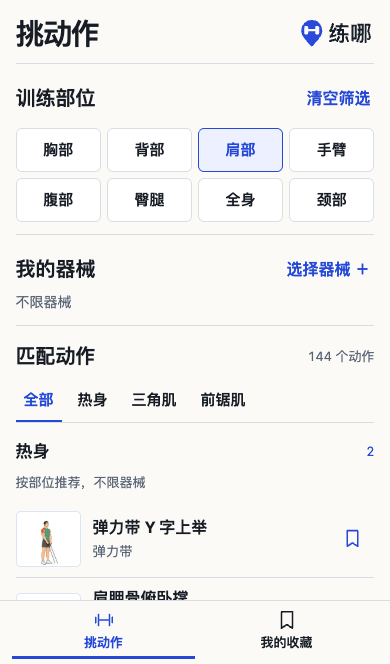
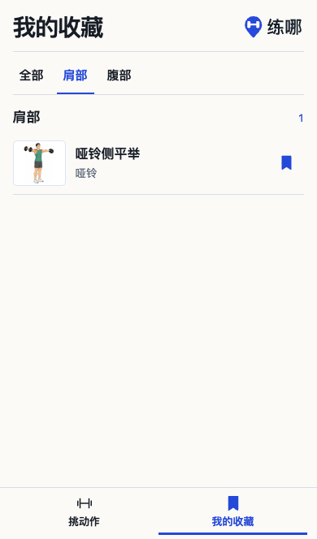
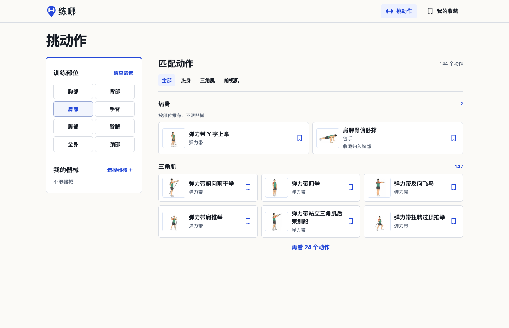
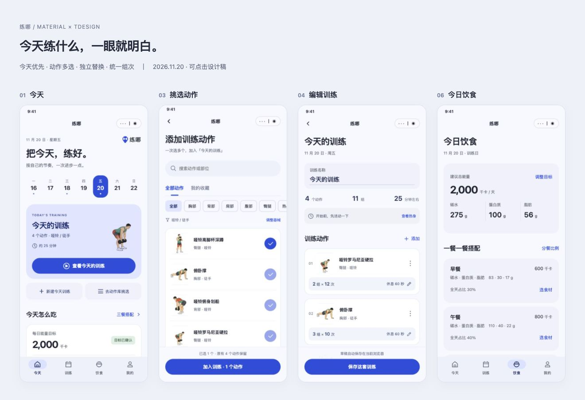
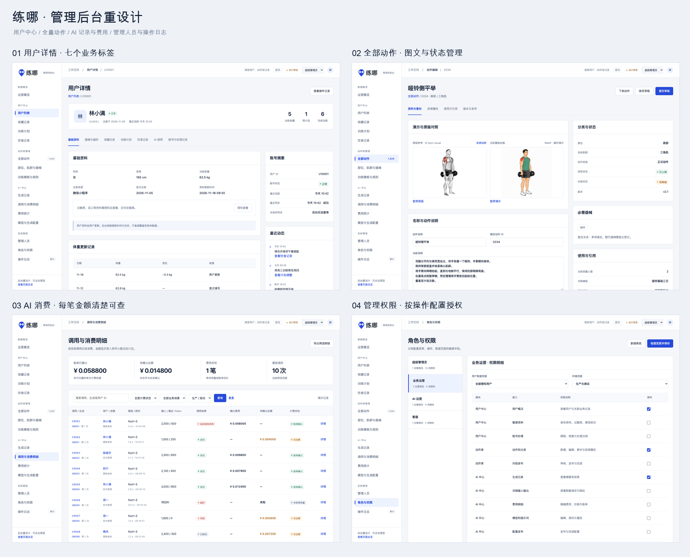

# 练哪

练哪是一个按训练部位和现有器械查找健身动作的网站。动作库收录 1,324 个动作，支持手机和电脑浏览。[打开练哪](https://lianna.yijiandot.com.cn/)

选好训练部位，例如肩部，再勾选手边的器械，就能按目标肌群查看匹配动作。热身按部位推荐，不受器械筛选限制。打开动作详情可以查看循环演示、器械和动作步骤，也可以直接在列表里收藏。器械清单和收藏保存在当前浏览器中，收藏可按训练部位查看。

## 产品截图

<table>
<tr><th>选择训练部位</th><th>选择器械</th></tr>
<tr><td></td><td></td></tr>
<tr><th>动作详情</th><th>按部位查看收藏</th></tr>
<tr><td></td><td></td></tr>
</table>

### 电脑端



## 本地运行

在仓库根目录运行以下命令，然后用浏览器打开 `http://localhost:8000`。

```sh
python3 -m http.server 8000 --directory "网站代码/dist"
```

网站代码和网页使用的动图、封面位于 [网站代码/dist](网站代码/dist)。要离线对照动作，下载完整仓库后，用浏览器打开 [新版动作库入口](动作库/新版动作库/打开动作库.html)。原始参考图、GIF、动作数据和说明位于 [原版项目](动作库/原版项目)。

原版训练媒体署名为 © Gym visual — https://gymvisual.com/ 。素材使用条件见[原项目许可](动作库/原版项目/LICENSE)和[媒体署名说明](动作库/原版项目/NOTICE.zh-CN.md)。

## 二版开发

二版小程序从「今天」进入周训练和三餐搭配，账号、排课、份量计算及内容审核由同一业务服务提供。开发和测试使用 Node.js 24。[本机启动与管理后台](二版后台/README.md)

## 微信小程序

[小程序源码与异机导入说明](微信小程序/README.md)。在微信开发者工具中导入含有 `project.config.json` 的 `微信小程序` 目录。

## 第二版需求与页面设计

第二版包含微信登录、训练计划、饮食推荐及电脑端管理后台。详见[第二版需求文档](docs/练哪小程序第二版需求.md)。

[最新小程序设计](docs/小程序_Material_TDesign/) · [小程序改版说明](docs/小程序_Material_TDesign/设计说明.md) · [制作工具与参考项目记录](docs/小程序_Material_TDesign/制作工具与参考项目.md) · [小程序及初版设计归档](docs/第二版页面设计/) · [新版后台需求文档](docs/练哪管理后台功能需求_重设计版.md) · [新版后台设计说明](docs/后台重设计稿/设计说明.md) · [新版后台设计文件](docs/后台重设计稿/)

- 小程序最新设计：Material 视觉层级 + TDesign 小程序组件规范，共 15 页。支持直接新建今天训练、多选与连续追加动作、独立替换、组次编辑；保留周计划、饮食与收藏。
- 新版管理后台：15 个主菜单及对应详情，覆盖用户资料、收藏、训练与饮食、全部动作、AI 生成和费用、管理员权限与操作日志。动作目录含完整 1,324 条记录与封面。
- 这些是可点击的 HTML 设计原型，不连接生产服务。新版小程序稿将训练草稿保存到当前浏览器；真实微信登录、云同步、AI 与生产发布未接入。TDesign 组件对应表和 WXSS 主题变量已交付，尚未集成小程序运行时。

### 最新小程序设计总览



[全部页面目录](docs/小程序_Material_TDesign/index.html) · [设计说明](docs/小程序_Material_TDesign/设计说明.md) · [制作记录](docs/小程序_Material_TDesign/制作工具与参考项目.md) · [验收记录](docs/小程序_Material_TDesign/验收记录.md)

### 新版管理后台设计总览



新版后台以[独立需求文档](docs/练哪管理后台功能需求_重设计版.md)为准，初版后台设计保留作历史参考。

### 在另一台电脑查看原型

拉取仓库后，用浏览器打开 `docs/第二版页面设计/index.html`，即可查看小程序与初版设计归档。也可在仓库根目录启动本地预览：

```sh
python3 -m http.server 8001 --directory "docs/第二版页面设计"
```

然后打开 `http://localhost:8001`。页面、截图和样例动图均包含在目录内，无需安装前端依赖。GitHub 文件页只展示 HTML 源码，交互体验需下载后在浏览器打开。


新版后台可直接打开 `docs/后台重设计稿/页面总览.html` 查看页面截图，或打开 `docs/后台重设计稿/index.html` 体验交互。也可在仓库根目录启动：

```sh
python3 -m http.server 8002 --directory "docs/后台重设计稿"
```

然后打开 `http://localhost:8002`。新版原型已包含所需脚本、1,324 个动作封面及 10 个动作的动态演示样例；用户、账单和管理操作均为演示数据，不连接真实服务。


### 查看最新小程序设计（Material × TDesign）

在仓库根目录运行：

```sh
python3 -m http.server 8003 --directory "docs/小程序_Material_TDesign"
```

打开 `http://localhost:8003/index.html` 看 15 页截图，或 `http://localhost:8003/mobile.html#today` 体验交互。设计包包含全部依赖素材，可以离线查看。工具、采用项目和版本记录见[制作工具与参考项目](docs/小程序_Material_TDesign/制作工具与参考项目.md)。
