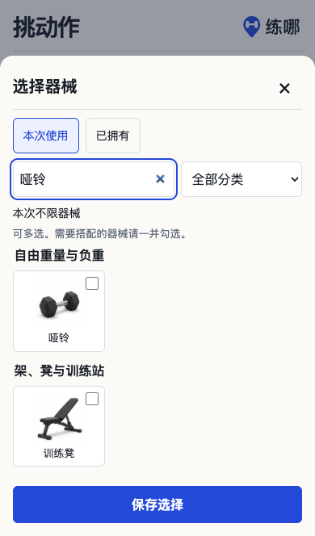
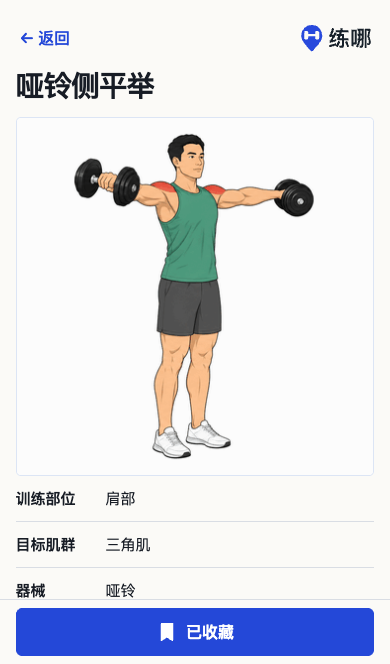

# 练哪

练哪是一个按训练部位和现有器械查找健身动作的网站。动作库收录 1,324 个动作，支持手机和电脑浏览。[打开练哪](https://lianna.yijiandot.com.cn/)

选好训练部位，例如肩部，再勾选手边的器械，就能按目标肌群查看匹配动作。热身按部位推荐，不受器械筛选限制。打开动作详情可以查看循环演示、器械和动作步骤，也可以直接在列表里收藏。器械清单和收藏保存在当前浏览器中，收藏可按训练部位查看。

## 产品截图

<table>
<tr><th>选择训练部位</th><th>选择器械</th></tr>
<tr><td></td><td></td></tr>
<tr><th>动作详情</th><th>按部位查看收藏</th></tr>
<tr><td></td><td></td></tr>
</table>

### 电脑端


## 本地运行

在仓库根目录运行以下命令，然后用浏览器打开 `http://localhost:8000`。

```sh
python3 -m http.server 8000 --directory "网站代码/dist"
```

网站代码和网页使用的动图、封面位于 [网站代码/dist](网站代码/dist)。要离线对照动作，下载完整仓库后，用浏览器打开 [新版动作库入口](动作库/新版动作库/打开动作库.html)。原始参考图、GIF、动作数据和说明位于 [原版项目](动作库/原版项目)。

原版训练媒体署名为 © Gym visual — https://gymvisual.com/ 。素材使用条件见[原项目许可](动作库/原版项目/LICENSE)和[媒体署名说明](动作库/原版项目/NOTICE.zh-CN.md)。
